# GBP Overlay

Turn any local-business website into a ready-to-upload set of keyword- and city-tagged Google Business Profile photos, in minutes instead of an afternoon in Canva.

> Built by **Satya Janghu**, a digital marketing expert specializing in SEO, AI search, and organic growth marketing. [getsatya.com](https://getsatya.com) · [satya@getsatya.com](mailto:satya@getsatya.com)


## Why it exists

Fresh, relevant photos are one of the easiest local-SEO signals to send through a Google Business Profile, and photos that carry the service keyword and the city reinforce what the business does and where. Producing them by hand means hunting through the business's website for usable images, deciding which service each one shows, working out which location it belongs to, and adding text in a design tool one image at a time. For a multi-location business that is hours of repetitive work per profile, and it is the first thing to slip when a team is busy. GBP Overlay does the whole job from a URL and a keyword list, and leaves a person in charge only of the review.

## What it does

- **Collects every usable photo from a website.** It reads the sitemap (including image sitemaps), respects robots.txt, and optionally renders JavaScript-heavy pages in headless Chromium. You can also upload your own images.
- **Drops near-duplicates before they cost anything.** Perceptual hashing removes images that are about 90% similar, so the same hero shot is never processed twice.
- **Matches each image to a service keyword with AI vision.** Gemini 2.5 Flash scores every image against your keyword list with a calibrated confidence rubric. Weak matches are set aside automatically and can be restored with one click.
- **Works out which city each photo belongs to.** Location pages are detected by AI and by URL patterns, then resolved to "City, ST", with your own location list as the fallback.
- **Places readable text where it does not cover the subject.** Each overlay goes in the calmest region of the photo and gets a contrast-checked background bar, rendered in one of 9 bundled font families.
- **Keeps a person in the loop.** A single review screen lets you include or exclude images and edit any keyword or location before anything is generated.
- **Delivers a clean, upload-ready package.** Files are named `location-keyword.jpg` (with a numeric suffix for repeats) and zipped with a `manifest.csv` that records the source URL and overlay position of every image.

## How it works

```mermaid
flowchart LR
    A["Setup: URL, keywords, locations, font"] --> B["FastAPI creates project"]
    B --> C["Celery pipeline"]
    C --> D["Crawl sitemap and pages"]
    D --> E["Perceptual-hash dedup"]
    E --> F["Gemini: detect location pages"]
    F --> G["Gemini: classify image to keyword"]
    G --> H["Resolve city and render previews"]
    H --> I["Review screen: include, edit, restore"]
    I --> J["Render overlays"]
    J --> K["ZIP + manifest.csv download"]
```



1. **Setup.** The user enters a website URL (or uploads images), a keyword list, optional locations, a font and how many images to take per page.
2. **Pipeline.** One Celery task runs the whole job and reports weighted progress: crawl (0–40%), AI location detection (40–50%), classification (50–80%), then location resolution and previews (80–100%). The React app polls every 3 seconds and shows each stage as it runs.
3. **Review.** Every image appears on one page, grouped by keyword. Edits are saved as you type.
4. **Generate and download.** Confirming starts overlay rendering, with a live feed of finished thumbnails. The finished ZIP is available for 24 hours, then cleaned up automatically.

## Engineering highlights

- **Distributed AI rate limiting.** A Redis-backed semaphore with atomic Lua acquire and release scripts holds every worker to 15 concurrent Gemini calls by default (`MAX_CONCURRENT_GEMINI`). Each slot expires after 120 seconds, so a stopped worker never holds capacity, and a local semaphore takes over if Redis is unavailable.
- **Cost-aware Gemini calls.** Calls retry up to 5 times on 429, 5xx and quota errors, with exponential backoff capped at 30 seconds, jitter, and `Retry-After` honored up to 60 seconds. Images are downscaled to 768 px before they are sent (originals are kept for rendering), location detection batches 40 pages per call, and `GEMINI_MOCK=true` runs the full pipeline offline.
- **A crawler that is safe to point at the open web.** A per-domain limit of 1 request per second is enforced across workers by an atomic Redis Lua script, with 5 fetch threads by default. An SSRF guard rejects private, loopback, link-local and reserved addresses and non-http(s) schemes on both the plain-HTTP and headless-browser paths, and child sitemaps are locked to the site's own domain.
- **Hard resource limits.** A 10-second request timeout, a 20 MB streamed cap per image, a 50-megapixel decompression-bomb guard, a 720 px minimum image width, and 200 pages / 500 images per project. In JavaScript mode one Chromium instance is reused with at most 2 pages open, which keeps memory flat.
- **A layered location cascade.** URL slugs after a location segment (`/locations/`, `/service-areas/` and similar) and Gemini's page detection come first, then a table of 32 unambiguous US cities, a dominant-state profile of the site, and a Gemini disambiguation into "City, ST". Images still without a city get the user's own locations round-robin, then a title and meta-description regex that recognizes all 50 states plus DC.
- **Deterministic overlay placement.** Six candidate positions are scored on an 800 px downsample: `0.35 × (1 − entropy) + 0.35 × (1 − Sobel gradient) + 0.15 × (1 − luminance variance) + 0.15 × bottom bias`. The translucent bar's opacity rises in steps until text contrast reaches 4.5:1, the WCAG AA target, and type is sized to the image (`min(w, h) / 25`, clamped to 20–56 px, shrunk to fit 85% of the width).
- **Reliable job handling.** Confirming a review is an atomic `UPDATE … WHERE status IN (…)`, so a double-click can never enqueue generation twice; a repeat gets HTTP 409. Jobs stuck in PENDING for 30 minutes are timed out, PostgreSQL runs through a 1–10 connection pool with startup retries, and an hourly Celery beat job removes expired files with TOCTOU-safe deletes.
- **Hardened web surface.** Signed session cookies (HttpOnly, Secure, SameSite=Lax), ownership checks on every project route, image preview and review override, path-traversal protection, allowlisted SQL column names, 500-character input limits, rate limits of 60 requests a minute (10 for project creation), and X-Frame-Options, nosniff, Referrer-Policy and HSTS headers.
- **Test suite.** 8 Playwright end-to-end tests in 5 spec files cover the health check, form validation, the projects dashboard, ZIP download, and the full crawl → review → generate → download flow. The full-flow test opens the ZIP, checks its magic bytes, counts the JPEGs, confirms `manifest.csv` is present, and attaches API timings to the report.

At a glance: about 4,100 lines of Python and 3,200 lines of TypeScript.

## Tech stack

| Layer | Technology |
|---|---|
| API | Python 3.11, FastAPI, Uvicorn, slowapi, itsdangerous |
| Jobs | Celery 5 (worker + beat) on Redis |
| Database | PostgreSQL 16 via psycopg2 connection pool |
| AI | Google Gemini 2.5 Flash (`google-generativeai`) |
| Crawling | requests, BeautifulSoup4, lxml, Playwright (optional) |
| Imaging | Pillow, NumPy, SciPy, imagehash |
| Frontend | React 19, TypeScript 5.9, Vite 6, Tailwind CSS 4, shadcn/ui, TanStack Query 5, React Router 7, react-hook-form + zod |
| Testing | Playwright Test 1.58 |
| Deploy | Railway (Nixpacks), single container running Uvicorn and Celery via `start.sh` |

## Project evolution

**Started as** a five-stage server-rendered workflow (Setup → Crawl & Collect → Match Keywords → Preview & Confirm → Generate & Download) that mirrored the manual Canva process step for step and proved the idea: crawl a site, classify photos, stamp text on them.

**Became** a three-step single-page app (Setup → Review → Download) backed by one unified Celery pipeline. The work moved behind the scenes, with distributed rate limiting, a location-inference cascade, scored overlay placement and an end-to-end test suite, so a person only steps in where judgment matters: the review.

## Roadmap

- Direct upload to Google Business Profile through the Business Profile API.
- User accounts and team workspaces.
- Multiple overlay variants per image.
- Custom font upload.
- Re-processing a single image without rerunning the project.
- Short video overlays.

## Running it locally

**Prerequisites:** Python 3.11+, Node 18+, PostgreSQL and Redis.

```bash
python -m venv .venv && source .venv/bin/activate
pip install -r requirements.txt
playwright install chromium            # optional, for JavaScript-rendered sites

cp .env.example .env                    # set SECRET_KEY, and GEMINI_API_KEY or GEMINI_MOCK=true
set -a; source .env; set +a             # the app reads environment variables, not .env directly
createdb gbp_overlay                    # tables are created on startup
redis-server &

uvicorn app.main:app --reload                                   # http://localhost:8000
celery -A app.tasks.celery_app worker --beat --loglevel=info    # in a second terminal
```

The built frontend in `app/static/dist` is served by FastAPI. For frontend work, run `cd frontend && npm ci && npm run dev` (port 5173, proxies `/api` to port 8000), and `npm run build` to refresh the bundle. All settings and defaults are listed in [`.env.example`](.env.example).

## Documentation

- [Product requirements](prd.md): the workflow, overlay specifications, image-handling and crawling rules, and sessions and storage.
- [Contributing](docs/CONTRIBUTING.md): dev setup, code style, implementation rules and testing.
- [Runbook](docs/RUNBOOK.md): deployment, health checks, tuning, file cleanup, rollback and monitoring.
- Code maps: [architecture](docs/CODEMAPS/architecture.md), [backend](docs/CODEMAPS/backend.md), [data model](docs/CODEMAPS/data.md), [dependencies](docs/CODEMAPS/dependencies.md), [frontend](docs/CODEMAPS/frontend.md).
- [Bundled fonts](app/static/fonts/README.md): the font families and their open licenses.

## About the author

> Built by **Satya Janghu**, a digital marketing expert specializing in SEO, AI search, and organic growth marketing. [getsatya.com](https://getsatya.com) · [satya@getsatya.com](mailto:satya@getsatya.com)

Satya automates the production work that local SEO depends on, so teams can put their hours into strategy instead of image editing.

## License

All rights reserved. See [LICENSE](LICENSE).
